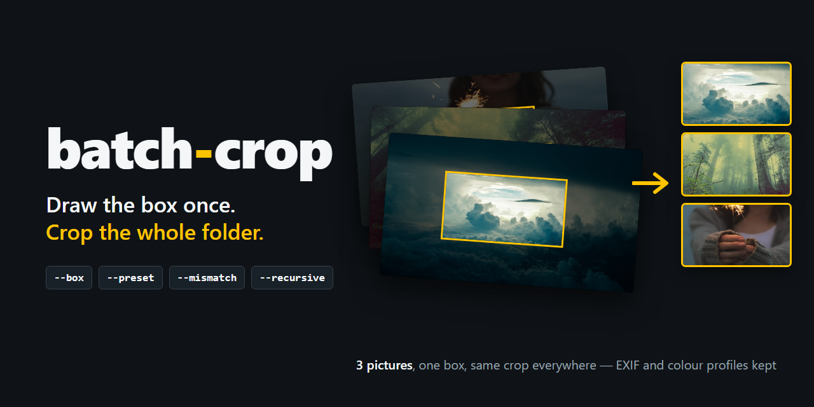
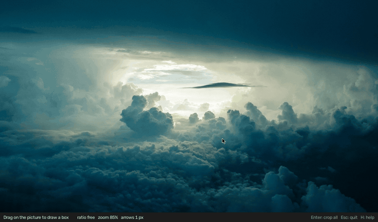
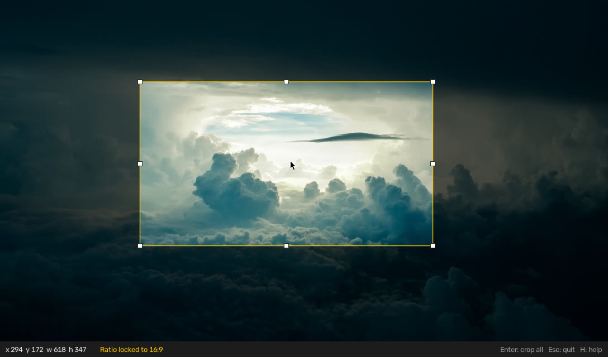
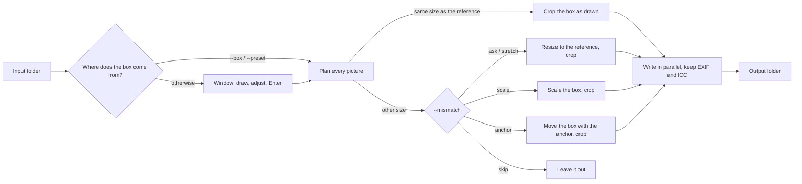

<p align="center">
  
</p>

# batch-crop-images

[](https://github.com/NatLee/batch-crop-images/actions/workflows/test.yml)


[](LICENSE)

Draw a crop box once, on one picture, and every picture in the folder gets the same crop. It is made for
images that share a layout: screenshots, scans, video frames, product photos, dataset images. A window
lets you draw the box and fine-tune it to the pixel. After that you can repeat the exact same crop from
the command line, without the window.



## Install

You need Python 3.10 or newer.

```bash
pip install "git+https://github.com/NatLee/batch-crop-images.git"
```

That gives you the `batch-crop` command (`python -m batch_crop` works too).

Working from a clone, the original way still works:

```bash
git clone https://github.com/NatLee/batch-crop-images.git
cd batch-crop-images
pip install -r requirements.txt
python main.py --input_path img/input --output_path img/result
```

On a minimal Linux system the window may need OpenGL and GLib: `sudo apt install libgl1 libglib2.0-0`.

## Quick start

```bash
batch-crop -i photos -o cropped
```

1. The first picture (by name) opens in a window. Big pictures are shown smaller so they fit the screen.
2. Drag a box. Drag inside it to move it, drag an edge or a corner to resize it, and use the arrow
   keys to nudge it one pixel at a time.
3. Press **Enter**. Every picture in `photos` is cropped into `cropped`, with the same file name and
   format. The originals are not changed.

The command then prints the box, so you can crop more pictures the same way without the window:

```text
Crop box: 294,172,618,347 (x,y,width,height) on the 1280x720 reference image 1.jpg
To crop the same way without the window, add --box 294,172,618,347
```

## In the window



| Do this | To |
|---|---|
| Drag outside the box | draw a new box (in any direction) |
| Drag inside the box / on an edge or corner | move it / resize it |
| Arrow keys | nudge the box by 1 px; **Tab** switches to nudging the top-left or bottom-right corner |
| `[` and `]` | nudge step 1, 10 or 50 px |
| `E` | type the box as `X,Y,W,H`, then Enter |
| `R` | lock the ratio: free, 1:1, 4:3, 3:2, 16:9, 3:4, 2:3, 9:16 |
| `A` | select the whole picture |
| `+` `-` `0` | zoom in, zoom out, fit (Windows and macOS: the mouse wheel too) |
| Right or middle drag | move the picture while zoomed in |
| Enter, Space, or double-click in the box | crop every picture |
| Esc or `Q` (or close the window) | quit; nothing is written |
| `H` | show all keys |

On Linux, OpenCV's window zooms with the mouse wheel by itself; use `+` and `-` instead, because a
left drag pans that built-in zoom.

## Examples

The examples use the demo pictures in [`img/input`](img/input): two are 1280×720, one is 1280×853.

### Crop without the window

```bash
batch-crop -i img/input -o cropped --box 294,172,618,347 --mismatch stretch
```

```text
Input:  /home/me/batch-crop-images/img/input  (3 images)
Output: /home/me/batch-crop-images/cropped
Crop box: 294,172,618,347 (x,y,width,height) on the 1280x720 reference image 1.jpg
written     cropped/1.jpg
written     cropped/2.jpg
written     cropped/3.jpg  (stretched from 1280x853 to 1280x720)
Done in 0.1 s: 3 written, 0 skipped, 0 failed.
```

### Save the box, reuse it later

```bash
batch-crop -i img/input -o cropped --save-preset box.json      # draw once, save the box
batch-crop -i more-pictures -o cropped --preset box.json        # same box, no window
```

The preset is plain JSON: the box and the size of the picture it was drawn on.

```json
{
  "format": "batch-crop-preset",
  "version": 1,
  "box": {"x": 294, "y": 172, "width": 618, "height": 347},
  "reference_size": {"width": 1280, "height": 720}
}
```

### Pictures of different sizes

The box is drawn on one picture, the *reference* (the first by name, or `--reference FILE`).
`--mismatch` decides what happens to pictures of another size:

| `--mismatch` | What happens | Output size |
|---|---|---|
| `ask` (default) | asks for each picture; yes = `stretch`, no = stop before writing anything | box size |
| `stretch` | resizes the picture to the reference size, then crops | always the box size |
| `scale` | scales the box with the picture: the same part of every picture | grows and shrinks |
| `anchor` | keeps the box's pixel size and its distance to `--anchor` (center, top, bottom-right, …) | always the box size |
| `skip` | leaves those pictures out | — |

Try them with `--dry-run`, which shows the plan and writes nothing:

```bash
batch-crop -i img/input -o cropped --box 294,172,618,347 --mismatch scale --dry-run
```

```text
would write cropped/1.jpg
would write cropped/2.jpg
would write cropped/3.jpg  (scale: box 294,204,618,411 on 1280x853)
Dry run: 3 would be written, 0 skipped, 0 failed. Nothing was written.
```

`anchor` suits screenshots of windows that changed size: anchor to the side your area is attached to.

```bash
batch-crop -i screenshots -o panels --box 960,0,320,720 --mismatch anchor --anchor top-right
```

### More

```bash
batch-crop -i photos -o cropped --aspect 1:1          # open the window with the ratio locked to a square
batch-crop -i photos -o cropped --recursive           # include sub-folders; the output mirrors them
batch-crop -i photos -o cropped --skip-existing       # keep files already in the output folder
batch-crop -i photos -o cropped --ext jpg png webp    # choose the file types (any letter case)
batch-crop -i photos -o cropped --quality 90 -j 4     # JPEG/WebP quality, 4 pictures at a time
```

## What is kept

- **Format and name**: `photo.jpg` becomes a cropped `photo.jpg`; PNG stays PNG.
- **Quality**: JPEG and WebP are saved at quality 95 (as before), or `--quality`.
- **Metadata**: EXIF (camera, date), the colour profile (ICC) and DPI are copied.
- **Pixels**: transparency, palettes and 16-bit depth are kept. Phone photos that are stored
  sideways are turned upright first, the way a photo viewer shows them.
- **Originals**: never touched, unless you choose the input folder as the output folder.
- **File names**: any characters work, including Chinese or Japanese names on Windows.

## How it works



Planning only reads the picture headers and asks its questions before anything is written, so
saying "no" or using `--dry-run` never leaves half a batch behind.

## All options

<details>
<summary><code>batch-crop --help</code></summary>

```text
usage: batch-crop [-h] [-i DIR] [-o DIR] [-r] [--ext EXT [EXT ...]] [--reference IMAGE]
                  [--box X,Y,W,H | --preset FILE] [--save-preset FILE] [--aspect W:H]
                  [--mismatch MODE] [--anchor SIDE] [--quality Q] [--skip-existing] [-n] [-j N]
                  [--quiet] [--version]

Draw a crop box on one image; every image in the folder is cropped the same way.

options:
  -h, --help            show this help message and exit

images:
  -i DIR, --input DIR, --input_path DIR
                        folder with the images to crop (default: img/input)
  -o DIR, --output DIR, --output_path DIR
                        folder for the cropped copies, created when missing (default: img/result)
  -r, --recursive       include sub-folders; the output folder gets the same sub-folders
  --ext EXT [EXT ...]   file extensions to crop, in any letter case (default: jpg jpeg png)
  --reference IMAGE     image to draw the box on and to compare sizes with (default: the first by
                        name)

crop box:
  --box X,Y,W,H         crop this box (pixels of the reference image) instead of drawing it
  --preset FILE         use a box saved earlier with --save-preset
  --save-preset FILE    save the box to FILE, to re-run the batch later without the window
  --aspect W:H          lock the box in the window to a ratio such as 16:9 or 1:1 (R in the window
                        cycles)

images of another size than the reference:
  --mismatch MODE       ask, stretch, scale, anchor or skip, explained below (default: ask)
  --anchor SIDE         for --mismatch anchor: center, top, bottom-right, ... (default: center)

output:
  --quality Q           JPEG and WebP quality, 1-100 (default: 95, the same as before)
  --skip-existing       keep files that already exist in the output folder (default: overwrite
                        them)
  -n, --dry-run         show what would be written; write nothing

running:
  -j N, --jobs N        images processed at the same time (default: 0, one per CPU core)
  --quiet               print only problems and the summary
  --version             show program's version number and exit
```

Exit codes: 0 done, 1 some pictures failed or you cancelled, 2 bad arguments or input folder.

</details>

## Coming from the old script?

Everything you used still works: `python main.py --input_path … --output_path …`, the same defaults
(`img/input` → `img/result`), the same file names, JPEG quality 95, and the same size question.
Three things changed on purpose:

- Releasing the mouse no longer starts cropping right away, so you can adjust the box first.
  Press Enter (or Space, or double-click inside the box).
- The size question is asked before anything is written, instead of halfway through the batch.
- Upper-case extensions such as `.JPG` are now included, and pictures are taken in name order.

## Development

```bash
pip install -e ".[test,lint]"
python -m pytest                     # engine, files, CLI and window logic; no screen needed
ruff check . && ruff format --check . && mypy
```

The window itself is tested by driving it with a real mouse and keyboard on a virtual screen:

```bash
docker build -f tests/gui/Dockerfile -t batch-crop-gui .
docker run --rm batch-crop-gui
```

On Windows, `BATCH_CROP_GUI_TESTS=1 python -m pytest -m gui` does the same on your desktop.
The demo GIF, the window screenshot and `img/result` are recorded with
[`docs/demo/record.sh`](docs/demo/record.sh); the cover is [`docs/images/cover.html`](docs/images/cover.html).

## Credits

The demo pictures are from [Free-Photos](https://pixabay.com/users/free-photos-242387) on Pixabay.
